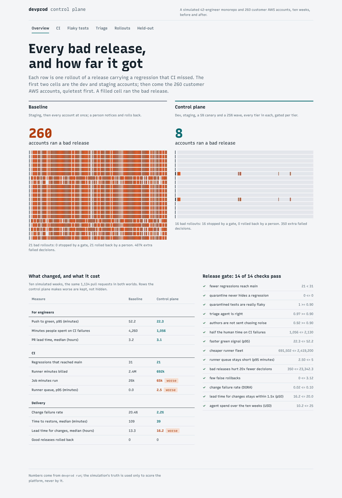

# devprod-control-plane

A developer-productivity control plane for a Python and TypeScript monorepo that deploys to many
customer AWS accounts. It covers CI selection and sharding, an autoscaled self-hosted runner fleet,
flaky-test quarantine, a CI-failure triage agent on the Claude Agent SDK, progressive delivery with
statistical gates, a paved road for new Lambda services, and an MCP server so engineers' own agents
(Claude Code, OpenCode) can use the platform.

It is measured, not described. A simulated 42-engineer organisation (25 modules, 1,134 pull requests,
260 customer accounts) runs for ten weeks twice: once with a good ordinary setup, once with the
control plane. The two worlds share their randomness, so the same test flakes on the same commit and
the same change is a regression in both. The platform only sees what GitHub, the CI and AWS would
record. The simulation's truth is used only to score it.



## Results

From `reports/RESULTS.md`, written by `devprod run` and checked in CI.

| | Baseline | Control plane |
|---|---|---|
| Push to green, p95 | 52 min | **22 min** |
| Minutes people spent on CI failures | 4,260 | **1,056** |
| Regressions that reached main (of 81) | 31 | **21** |
| Runner minutes billed | 2.42M | **0.69M** |
| Customer accounts that ran a bad release | 260 | **8** |
| Change failure rate (DORA) | 20.4% | **2.2%** |
| Time to restore, median | 109 min | **39 min** |
| Good releases rolled back | 0 | 0 |

What it costs, kept in the table rather than hidden:

- **More CI work.** 2.5 times the job minutes, because a change to a library also runs everything
  that depends on it.
- **A short queue.** Runners queue for a p95 of 2.5 minutes, the price of not paying for 24 idle runners.
- **More failed first runs.** 18.7% against 11.9%: more jobs give a runner more chances to die and a
  flaky test more chances to flip. The agent reruns most of these without anyone looking.
- **Slower delivery.** Lead time for changes rises from 13.3 to 16.2 hours (median), because releases
  bake in waves and respect customers' deploy windows.
- **Model spend.** The triage agent costs about $10 over the ten weeks at list price.

The **triage agent** was right on 97% of the simulated failures. When it blamed the change it was
right 92% of the time, and it found every real regression. The **flake detector** quarantined 16
tests, none wrongly, and quarantine never hid a regression. The **usual canary** (the quietest
starter accounts, one pooled gate), run on the same releases as an ablation, let 141 accounts run a
bad release. Stratified waves with a gate per tier let 8.

## Held-out CI failures

The triage agent was first written against the simulator's own logs. Someone who had not seen the
code then wrote 44 real-looking CI failures from [`heldout/WRITING_FAILURES.md`](heldout/WRITING_FAILURES.md)
alone. The cases cover pytest-xdist, Jest, Vitest, pip, uv, pnpm, runner deaths, outages, and a
change's own bad pin. **The agent got 50% right on that first run**
([`reports/heldout/ci-failures-1/first_run.json`](reports/heldout/ci-failures-1/first_run.json),
never rewritten). It did not recognise most real log formats, and it blamed registries for
install failures that a change's own manifest had caused.

That set is now a regression set (`STATUS: regression`). The agent was generalised and passes it.
A second set was written blind afterwards to measure the generalised agent:

| Set | Written | First run, kind right | Status |
|---|---|---|---|
| `ci-failures-1` | blind, before the agent was generalised | **50%** (22 of 44) | regression set: studied, now passes 100% |
| `ci-failures-2` | blind, after | **92%** (37 of 40) | held out, not studied |

On `ci-failures-2` the agent was right on every infra and dependency case. It never told an author
that a flake was their fault. Its three misses were failures it could not read, so it fell back to
"rerun": one unittest-style traceback, one Vitest log, and one component test in a module the change
cannot reach. Those logs have not been studied: doing so would turn the set into a regression set
and need a third blind set.

## How it works

```
GitHub ── webhook (HMAC, once per delivery) ──▶ control plane (Lambda + DynamoDB)
   │                                                 │
   │  per-module workflows (generated)               ├─▶ runner scaler (SQS ▶ Lambda ▶ ASG of ephemeral Graviton runners)
   │  path filters incl. dependencies                ├─▶ triage agent (Claude Agent SDK, guarded MCP tools)
   │  duration-balanced shard matrix                 └─▶ rollout worker (waves, windows, per-tier gates, rollback)
   │  ci-gate: the one required check                           │ STS per account
   ▼                                                            ▼
engineers ◀── MCP server (Claude Code, OpenCode) ──  260 customer AWS accounts (CloudFormation, CodeDeploy, CloudWatch)
```

- **CI** (`src/devprod/ci`). A module graph decides what a change runs: its modules and everything
  that depends on them. Tests are sharded by recorded duration (longest first, onto the least loaded
  shard). One workflow is generated per module, with pinned actions, keyed caches, self-hosted labels
  and concurrency. Path-filtered required checks never report when skipped, so a `ci-gate` workflow
  waits for exactly the module workflows the filters start, and it is the only required check.
- **Runners** (`infra/runners`, `src/devprod/ci/scaler.py`). Ephemeral just-in-time runners run on
  Graviton Spot with an on-demand base. A runner protects itself from scale-in while a job runs. The
  scaler adds runners for queued jobs and lets idle ones go, never below a working-hours floor.
- **Flaky tests** (`src/devprod/flaky`). A flip is a failure that passes on the same commit. Each
  test's flip rate has a Beta posterior, and its owner gets a deadline. Tests are never quarantined in
  a module the change touches ([ADR 2](docs/adr/0002-quarantine-from-flips.md)).
- **Triage** (`src/devprod/agent`). The same tools back three runners: a rule-based stand-in (in CI
  and the simulation), the Claude Agent SDK runner, and the MCP server.
  - The SDK runner has no built-in tools, two Haiku subagents (log reader, history checker), a JSON
    answer schema and a budget.
  - A PreToolUse hook allows one rerun, comments and proposals, and denies reverts and quarantine on
    main ([ADR 4](docs/adr/0004-triage-agent-proposes-people-decide.md)).
  - A suspected regression is rerun once before the author is told.
- **Delivery** (`src/devprod/deploy`). A resumable rollout state machine runs dev, staging, a 5%
  canary and a 25% wave, then the rest. Every customer wave takes every tier. Gates are one-sided
  binomial tests per tier, with alpha split over the whole rollout
  ([ADR 3](docs/adr/0003-stratified-waves-and-per-tier-gates.md)). AWS adapters cover STS per
  account, CloudFormation, CodeDeploy canaries and CloudWatch. A DynamoDB worker with
  version-conditioned writes means no rollout is advanced twice.
- **Paved road** (`src/devprod/paved`). `devprod new pricing-sim --dep core` writes a Lambda module:
  a handler with structured logs, tests, a sample event, a SAM template (arm64, alias, canary with an
  alarm), its workflow and a CODEOWNERS line. It tests green and is invoked locally in milliseconds
  with `devprod dev invoke`.
- **For agents** (`src/devprod/service/mcp_server.py`, `.mcp.json`, `opencode.json`,
  `.claude/agents/ci-triage.md`). Read-only tools let an agent explain a run, see what a change
  will run, look up flake history, and read metrics, workflows and the scaffolding plan for a new
  module.
- **Dashboard** (`web/`). React 19, motion and Recursive. Loading, error and empty states throughout.
  Tested with Vitest and with Playwright under the production CSP.

## Run it

```bash
uv sync
uv run devprod run              # both worlds, evaluation, reports/, release gate (~15 s)
uv run pytest -q                # 122 tests, incl. moto for AWS, the MCP server and the pipeline
uv run devprod triage --run 3   # what the agent says about a failed run
uv run devprod new pricing-sim --dep core --root /tmp/mono && uv run devprod dev test pricing-sim --root /tmp/mono
uv run devprod export-web && (cd web && npm ci && npm run dev)   # http://127.0.0.1:5207
claude mcp add devprod -- uv run devprod serve-mcp               # the platform inside Claude Code
DEVPROD_AGENT=claude ANTHROPIC_API_KEY=... uv run devprod triage --run 3   # the Claude Agent SDK runner
```

## Limits

- **The organisation is simulated.** Its assumptions (flake rates, how long people take to
  investigate, what a bad release does) are in `config/org.yaml` and drive every number above. The
  baseline fleet is 24 runners around the clock. A team that already scales its fleet saves less.
- **No model key was used.** The numbers come from the rule-based stand-in. The Claude Agent SDK
  runner is built and tested for its options, guard, tools and schema, but has not been scored.
- **Nothing was deployed.** The Terraform is validated in CI, the CloudFormation passes cfn-lint, and
  the AWS adapters are tested against moto, not real accounts.
- **The DynamoDB worker scans for due rollouts.** That is fine for a handful in flight; with many it
  would need an index on state.
